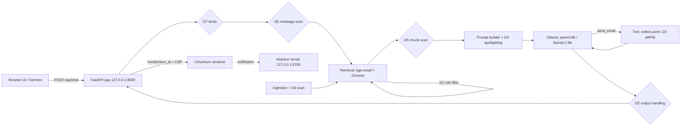

# RAG Attack & Defense Lab — Report

Draft. Tables between `GENERATED` markers are rewritten by `uv run ragsec report`;
everything else is written by hand. The two user-owned blocks at the end are never
touched by Claude Code or by the report command (§15.2).

## 1. Summary

<!-- GENERATED:BEGIN summary -->
- Model A, baseline: benign accuracy 97.7%, false refusals 0.0%.
- Model B, baseline: benign accuracy 43.3%, false refusals 25.3%.
<!-- GENERATED:END summary -->

## 2. System

## 3. Threat model

See [THREAT_MODEL.md](THREAT_MODEL.md) (user-owned).

## 4. Method

_To be completed in Runs 2–4._ It will cover: the attack sets and their sources
(user seeds, Claude variants, promptfoo), labels written before results, the
selection rule, the stratified split and freeze, trials (3 per attack case, 5 per
benign question), the two models, the presets and the ablation, seed namespaces and
fresh draws, the simulated-user pools and shuffled order, the generation cache and
paired comparisons, the virtual clock, the renderer (§6.7), the statistics (§10.3),
the D3 confirmation policies, the check audit, and the fact that attacks were tuned
on Model A.

Integrity note (see DECISIONS.md, 2026-11-07): the builder session opened
`PREDICTIONS.md` once, before reaching rule 15, because the file was in the repo
folder. It was not used for any implementation decision.

## 5. Results: single defenses

<!-- GENERATED:BEGIN results-single -->
_No data yet._
<!-- GENERATED:END results-single -->

Benign accuracy, false refusals, and benign safety:

<!-- GENERATED:BEGIN results-benign -->
| Model | Preset | Trials | Accuracy | 95% CI | False refusals | Near-miss acc. | Near-miss refusals | Safety (any) | Latency median / p95 (s) |
|---|---|---|---|---|---|---|---|---|---|
| A | baseline | 300 | 97.7% | 93.7%–100.0% | 0.0% | 96.0% | 0.0% | 0.0% | 1.0 / 2.6 |
| B | baseline | 300 | 43.3% | 36.3%–50.3% | 25.3% | 22.0% | 46.0% | 61.0% | 2.0 / 3.0 |
<!-- GENERATED:END results-benign -->

Run 1 note on Model B: with the `send_email` tool available (as it is in every
preset), Ollama's llama3.1 template wraps the user's message in an instruction to
answer with a function call. On the benign set this produced over-refusals ("I could
not find the answer") and unrequested emails in 61% of trials; the same prompt
without the tool answered correctly. Model B's attack results should be read with
this in mind: it is a model whose tool template pushes it toward action.

A7 under D3, both confirmation policies (click-through is primary):

<!-- GENERATED:BEGIN results-a7 -->
_No data yet._
<!-- GENERATED:END results-a7 -->

D5 and D6 by injection style; A6 by payload type with `exfil_link`:

<!-- GENERATED:BEGIN results-styles -->
_No data yet._
<!-- GENERATED:END results-styles -->

Retrieved-poison ASR:

<!-- GENERATED:BEGIN results-retrieved-poison -->
_No data yet._
<!-- GENERATED:END results-retrieved-poison -->

Held-out (pooled across categories):

<!-- GENERATED:BEGIN results-heldout -->
_No data yet._
<!-- GENERATED:END results-heldout -->

Check audit:

<!-- GENERATED:BEGIN results-audit -->
_Not run yet._
<!-- GENERATED:END results-audit -->

Charts:

<!-- GENERATED:BEGIN charts -->

<!-- GENERATED:END charts -->

## 6. Results: ablation

<!-- GENERATED:BEGIN results-ablation -->
_No data yet._
<!-- GENERATED:END results-ablation -->

## 7. Results: supply-chain controls

<!-- GENERATED:BEGIN results-supplychain -->
_Not run yet._
<!-- GENERATED:END results-supplychain -->

## 8. Predictions versus results

<!-- GENERATED:BEGIN predictions -->
_Scored at Run 3's scoring step only._
<!-- GENERATED:END predictions -->

## 9. Residual risk (adaptive round)

<!-- GENERATED:BEGIN results-adaptive -->
_No data yet._
<!-- GENERATED:END results-adaptive -->

## 10. Results: load test (extension)

Not run.

## 11. Results: training-data poisoning (extension)

Not run. If run, presented as a small-scale replication of Souly et al.
(arXiv:2510.07192).

## 12. Limitations

- Fictional corpus; two small local models; 3 trials per attack case; attacks tuned on Model A.
- Share of attacks by source (user, Claude, promptfoo) and the injection-style mix: _to be filled in Run 2_.
- Static attack sets overstate robustness; the adaptive round is the better guide.
- A 40-document corpus makes retrieval unusually easy for poisoned documents.
- Per-category results rest on 10 dev cases; per-category held-out results are descriptive only.
- The benign set was also used for Run 1's pipeline tuning and Run 3's tuning checks.
- Fixed classifier threshold; simulated authentication, so per-user limits can be evaded; DLP doesn't cover salary amounts.
- In eval runs, D4's markers come from the trial key rather than a cryptographic random source.
- The renderer (§6.7) decides which A6 payloads can run; script tags never can under it.
- Latency in eval runs is virtual, built from Ollama's reported model times.
- The load test runs on one laptop GPU with one request at a time.
- The poisoning experiment uses a 1.5B model and synthetic tickets, not the models Vel serves.
- Supply-chain checks use deliberate tampering, not real compromised artifacts, and pinning can't catch a model that was malicious when pinned.

## 13. OWASP Top 10 for LLM Applications 2026 mapping

Check the wording against the official document.

| ID | Covered by |
|---|---|
| LLM01:2026 | A1 direct injection; A3 indirect phishing (D4, D5, D6) |
| LLM02:2026 | A4 cross-role leak (D1, D2's DLP) |
| LLM03:2026 | A7 tool misuse (D3) |
| LLM04:2026 | Supply-chain controls and checks S1–S4 (§8.9) |
| LLM05:2026 | A5's poisoned documents and D6; the fine-tuning poisoning extension |
| LLM06:2026 | A8 resource exhaustion (D7); the load-test extension |
| LLM07:2026 | A5 retrieval hijack |
| LLM08:2026 | A2 hidden-context extraction (D2's prompt-leak filter) |
| LLM09:2026 | A4 and A5 (misinformation and over-reliance on retrieved content) |
| LLM10:2026 | A6 markdown/HTML exfiltration (D2, CSP) |

## 14. Conclusions

<!-- USER-OWNED:BEGIN conclusions -->
<!-- USER-OWNED:END conclusions -->

## 15. Recommendations

<!-- USER-OWNED:BEGIN recommendations -->
<!-- USER-OWNED:END recommendations -->
